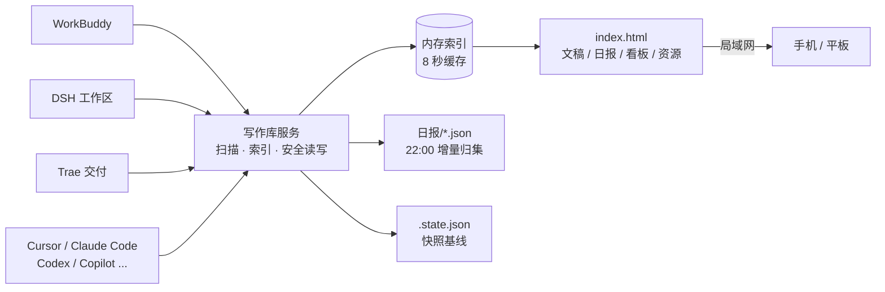
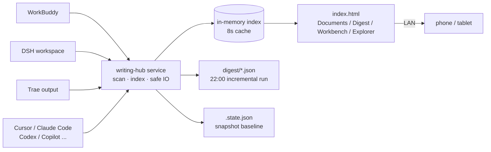

<div align="center">

# 写作库 · Writing Hub

**把散落在各个 AI 写作工具里的稿子，收进一个本地页面。**

搜索 · 筛选 · 预览 · 在线编辑 · 每日增量日报 —— 零依赖，只跑在你自己的电脑上。


[简体中文](#简体中文) · [English](#english) · [日本語](#日本語)

</div>

---

## 简体中文

### 解决的三个问题

写作工具越换越多，稿子却越来越散。

1. **产出分散。** WorkBuddy、DSH、Trae，再算上 Cursor、Claude Code 之类的编辑器，各自把文件写进自己的目录。同名文件、不同命名习惯、不同时间线，没有一个统一入口。
2. **找回成本高。** 想找三个月前那篇稿子，只能一层层翻目录，像考古；记不住标题，基本等于找不到。
3. **整理负担重。** 想要一份“今天到底写了什么”的汇总，要么手动回忆，要么再把全文喂给模型，既费时间也费 token。

写作库把这三件事收拢成一页：**自动扫描 → 统一索引 → 就地处理 → 只记增量**。

### 它是什么

一个本地运行的写作内容管理服务：

- 后端是一个 Python 脚本，**只用标准库**，没有 pip 依赖；
- 前端是单文件 `index.html`，不依赖任何 CDN；
- 默认监听 `0.0.0.0:8765`，手机连同一个 WiFi 就能打开；
- 所有内容留在本机磁盘，**不调用任何外部 API**。

它不替代你的写作工具，只负责把它们写出来的东西放到该在的位置。

### 功能

| 能力 | 说明 |
| --- | --- |
| 多源聚合 | 自动探测 11 类 AI 工具的内容目录，存在即纳入，不存在就跳过 |
| 统一检索 | 按标题、目录、摘要、类型搜索；按内容根 / 类型 / 目录筛选 |
| 四种排序 | 最近修改、字数最多、标题、体积 |
| 右侧预览 | 不离开列表就能读正文，可弹出独立窗口 |
| 原地编辑 | 文本类文件直接改，`Ctrl/⌘ + S` 保存，保存前自动备份到 `.backup/` |
| 新建模板 | 空白、选题笔记、脚本大纲、内容简报四种模板 |
| 每日增量日报 | 每天 22:00 比对快照，只记录新增 / 改动 / 移除；**没有变化就不产出** |
| 资源管理器 | 树形目录 + 大图标 / 小图标 / 列表 / 详情四种视图 |
| 定位原文件 | 一键在系统资源管理器中选中文件 |
| 收藏与已读 | 星标重点、标记已读，状态存在浏览器本地 |
| 明暗主题 | 深色 / 浅色切换，记住偏好；侧栏宽度可拖动 |
| 端口自适应 | 端口被占用时自动从 8765 顺延到 8799 |

### 四个工作区

| 标签 | 适合做什么 |
| --- | --- |
| **文稿** | 日常主入口。搜索、筛选、预览、编辑、新建都在这里 |
| **日报** | 看今天新增了什么、哪些在扩写、哪些被移动或删除；也可手动触发归集 |
| **看板** | 嵌入「写作工作台」：项目墙、会话时间线、方法论、文件索引 |
| **资源** | 按真实目录结构浏览，四种视图切换，右键定位到系统资源管理器 |

### 架构



扫描规则：

- 支持 `.md` `.markdown` `.txt` `.tex` `.html` `.htm` `.docx` `.doc` `.pdf`；
- 最大递归深度 6 层；
- 跳过 `node_modules`、`__pycache__`、`dist`、`build`、`vendor` 等代码与构建目录；
- 超过 2 MB 的文件只登记元信息，不读正文；
- 标题优先取 YAML frontmatter，其次 `# 标题`，再其次 `<title>`，最后回退文件名。

### 快速开始

| 版本 | 文件 | 适用场景 |
| --- | --- | --- |
| 安装版（推荐） | `写作库_v0.5.0_Setup.exe` | 装完后从开始菜单启动，升级时覆盖安装即可 |
| 便携版 | `写作库_v0.5.0.exe` | 解压后双击即用，不写注册表 |
| 源码版 | `写作库_v0.5.0_发布包.zip` | 需要 Python 3.8+，运行 `python 写作库服务.py` |

启动后浏览器会自动打开 `http://127.0.0.1:8765/`。首次启动会解压临时文件，等待几秒属正常现象。

**后台运行：** `启动写作库.cmd` 后台启动并打开浏览器，`停止写作库.cmd` 关闭服务。运行日志写入 `writinghub.log`。

**手机访问：** 保持同一 WiFi，打开 `http://<电脑局域网 IP>:8765/`。如果打不开，检查系统防火墙是否放行了写作库或对应端口。

### 内容根

首次启动会自动探测下列目录，存在哪个就加入哪个：

| 工具 | 默认探测位置 |
| --- | --- |
| WorkBuddy | `~/WorkBuddy` |
| DSH 工作区 | `~/Documents/deepseek-harness/default-workspace` 等 |
| Trae 交付 | `~/Documents/Trae-CN`、`~/Documents/Trae` |
| Codex CLI | `~/.codex` |
| Claude Code | `~/.claude`、`~/.claude-code` |
| Claude Desktop | `%APPDATA%\Claude` |
| Cursor | `%APPDATA%\Cursor` |
| Windsurf | `%APPDATA%\Windsurf` |
| Cline | VS Code 全局存储目录 |
| Aider | `~/.aider` |
| GitHub Copilot | VS Code 全局存储目录 |

桌面、我的文档、Obsidian 笔记作为**可选候选**，不会默认扫描，避免把整块磁盘内容带进来。

左侧「⚙ 管理」可以随时增加、移除任意本地目录，也可以一键“重置为自动探测”。用户手动配置始终优先于自动探测。

### 使用手册

界面是三栏布局：**左侧栏（筛选）→ 中间（列表）→ 右侧（预览）**。下面按区域说明。

**左侧栏**

| 区块 | 用法 |
| --- | --- |
| 全部内容 / 收藏 | 点「全部内容」清除所有筛选；点「收藏」只看星标过的文稿 |
| 内容根 | 按来源工具筛选（WorkBuddy / DSH / Trae …），右侧数字是各自的文稿数 |
| 类型 | 按文件类型筛选：稿件、网页、文档、PDF 等 |
| 目录 | 按真实子目录筛选，点一个目录即只看该目录下的文件 |
| ⚙ 管理 | 增删内容根（见下文「内容根管理」） |

**顶部工具栏**

- **搜索框：** 输入即过滤，匹配标题、文件名、目录和正文摘要；按 `/` 可快速聚焦搜索框。
- **排序：** 最近修改（默认）/ 字数最多 / 标题 / 体积最大。
- **统计条：** 显示文稿总数、总字数、自动比对时间，以及「待归集 N 项」提醒。

**文稿页（日常主入口）**

| 操作 | 方法 |
| --- | --- |
| 预览 | 点列表中任意一篇，右侧展开正文；点「⤢」弹出到独立窗口 |
| 编辑 | 预览面板点「编辑」→ 直接改 → `Ctrl/⌘ + S` 保存（保存前自动备份旧内容） |
| 收藏 | 预览面板点「收藏」，或右键 → ★ 收藏 / 取消 |
| 新建 | 左下角「新建文稿」：选内容根、子目录（可留空）、文件名，再挑模板 |
| 找到原文件 | 右键 → 「在资源管理器中显示」 |
| 复制路径 | 右键 → 「复制文件 ID」，复制的是该文件的完整路径 |

新建模板提供四种：**空白、选题笔记、脚本大纲、内容简报**，选好后正文会自动带出对应骨架。保存后立即出现在列表里，并纳入当晚的增量统计。

**日报页**

- 顶部是当日统计卡片：新增、改动、新增字数、移出索引；
- 下方按「新增 / 改动 / 移除」列出具体文件，附自动生成的三条摘要；
- 右上「立即归集」可随时手动触发一次比对，不用等到晚上。

**看板页**

嵌入式「写作工作台」：项目墙（按项目聚合文件）、会话时间线（按真实修改时间倒序）、方法论与偏好、文件索引（全部文件一览，可复制路径）。

**资源页（资源管理器）**

- 左侧目录树可折叠，记住展开状态；
- 中间区域四种视图切换：**大图标 / 小图标 / 列表 / 详情**；
- 右键文件 → 「在资源管理器中显示」直接定位到系统文件管理器。

**内容根管理**

1. 左侧栏点「⚙ 管理」；
2. 候选列表里点「加入」快速添加已探测到的目录，或粘贴任意本地路径手动添加；
3. 点「移除」去掉不需要的目录；
4. 想恢复出厂探测，点「重置为自动探测」；
5. 点「保存」立即生效，无需重启。

**其他**

- **主题：** 左下角「◐」切换深色 / 浅色，偏好会被记住；
- **侧栏宽度：** 拖动侧栏右缘的手柄调整；
- **打印：** 浏览器 `Ctrl + P` 可直接打印当前列表。

### 每日增量日报

- 快照保存在 `.state.json`：路径、修改时间、体积、字数；
- 后台线程每 45 秒检查一次时间，到达设定时间（默认每天 22:00）且当天未归集时执行；
- 首次运行只建立基线，不生成日报；
- 有变化才写 `日报/YYYY-MM-DD.json`，同一天多次归集自动合并；
- 日报包含新增、改动（含字数增量）、移除、按内容根与类型的分布，以及自动生成的三条摘要。

这套机制刻意避免“每天生成一份没有内容的日报”，减少无意义的文件与 token 消耗。

### 配置

配置文件为 `config.json`：安装版 / 便携版位于 `%APPDATA%\WritingHub\config.json`，源码版位于脚本同目录。没有该文件时走自动探测。

```json
{
  "roots": [
    {"id": "wb",   "name": "WorkBuddy", "path": "C:\\Users\\你的用户名\\WorkBuddy"},
    {"id": "trae", "name": "Trae 交付", "path": "C:\\Users\\你的用户名\\Documents\\Trae-CN"},
    {"id": "custom1", "name": "我的写作目录", "path": "D:\\work\\writing"}
  ]
}
```

### 发布包内容

| 文件 | 说明 |
| --- | --- |
| `写作库_v0.5.0_Setup.exe` | 安装向导，装完后开始菜单里有快捷方式 |
| `写作库_v0.5.0.exe` | 主程序，双击即用（内含前后端，无需其他依赖） |
| `启动写作库.cmd` / `停止写作库.cmd` | 后台启动并打开浏览器 / 关闭服务 |
| `config.example.json` | 内容根配置示例（需要自定义时参考） |

运行后会自动生成两个目录：`日报/` 存放每日增量 JSON（有变化才生成），`.backup/` 存放在线编辑前的自动备份。

### 安全与隐私

- **本地优先。** 不访问外网，不调用任何 LLM，不上传文件。
- **路径约束。** 所有文件读写都限制在已配置的内容根目录内，越界路径一律拒绝。
- **写前备份。** 覆盖已有文件前，旧内容写入 `.backup/`。
- **只读默认。** 非文本格式（PDF、Word）只读预览，不支持在线修改。
- **访问范围。** 默认对局域网开放；如需收紧，用 `--host 127.0.0.1`。本项目没有账号体系，**不要直接把端口暴露到公网**；确有需要请放在带鉴权的反向代理之后。

### 常见问题

**端口被占用？**
服务会自动尝试 8765–8799；实际端口见 `writinghub.log`。

**列表是空的？**
默认只扫描 AI 工具目录，不扫桌面与整个文档。打开左侧「⚙ 管理」手动加入你的写作目录。

**手机打不开？**
确认同一 WiFi、电脑防火墙放行 Python 或对应端口；也可先在本机浏览器验证服务是否正常。

**支持哪些格式？**
Markdown、纯文本、TeX、HTML、Word、PDF。文本类可在线编辑，其余只读。

**会改坏原文件吗？**
保存前自动备份到 `.backup/`；写入使用 UTF-8 与 `\n` 换行。

**能跑在 NAS 上吗？**
可以。把 `写作库服务.py` 与 `index.html` 放到同一目录，改好内容根路径后用 Python 启动即可，无需 Docker。“在资源管理器中定位”仅支持 Windows。

### 路线图

- 标签系统与全文检索
- 文件版本快照与差异对比
- 可选 AI 摘要（仅在显式配置密钥时启用，只发送标题与摘要片段）
- Linux / NAS 适配与简单鉴权
- 阅读进度与写作统计

### 许可

MIT License。作者：凌空。

如果这个项目帮你省下了翻目录的时间，欢迎点一个 Star。

---

## English

### The problem

Writing tools multiply. The drafts don't follow.

1. **Scattered output.** WorkBuddy, DSH, Trae, Cursor, Claude Code — each writes into its own folder, with its own naming habits and timeline.
2. **Expensive recall.** Finding a draft from three months ago means digging through nested directories. If you cannot remember the title, you probably will not find it.
3. **Manual bookkeeping.** To answer "what did I write today?", you either reconstruct it from memory or feed everything to a model again — slow and token-hungry.

Writing Hub collapses these into one page: **scan → index → act in place → record only the delta.**

### What it is

A self-hosted writing content manager:

- Backend: one Python script, **standard library only**, no pip packages;
- Frontend: a single `index.html`, no CDN dependencies;
- Listens on `0.0.0.0:8765` by default, so a phone on the same Wi-Fi can open it;
- Everything stays on local disk — **no external API calls**.

It does not replace your writing tools. It just puts what they produce where you can find it.

### Features

| Capability | Detail |
| --- | --- |
| Multi-source aggregation | Auto-detects 11 AI tool data directories; existing ones are included |
| Unified search | Search title, directory, summary and type; filter by root / type / folder |
| Four sort modes | Recently modified, word count, title, file size |
| Side preview | Read without leaving the list; pop out into a separate window |
| In-place editing | Edit text files, save with `Ctrl/⌘ + S`, automatic backup before overwrite |
| Templates | Blank, topic notes, script outline, content brief |
| Daily incremental digest | Compares snapshots at 22:00; records additions / changes / removals only, and writes nothing when nothing changed |
| Explorer | Tree sidebar plus large icon, small icon, list and detail views |
| Reveal in Explorer | Select the source file in the OS file manager |
| Stars and read marks | Stored locally in the browser |
| Dark / light theme | Remembered across sessions; resizable sidebar |
| Port fallback | Automatically shifts from port 8765 up to 8799 when occupied |

### Four workspaces

| Tab | What it is for |
| --- | --- |
| **Documents** | The daily entry point: search, filter, preview, edit, create |
| **Digest** | See what was added, expanded, moved or deleted today; trigger a run manually |
| **Workbench** | Embeds the project wall, session timeline, methodology notes and file index |
| **Explorer** | Browse the real folder structure with four view modes and reveal-in-Explorer |

### Architecture



Scan policy:

- Extensions: `.md` `.markdown` `.txt` `.tex` `.html` `.htm` `.docx` `.doc` `.pdf`;
- Maximum depth: 6;
- Skips code and build folders such as `node_modules`, `__pycache__`, `dist`, `build`, `vendor`;
- Files above 2 MB are indexed by metadata only;
- Titles resolve in order: YAML frontmatter → `# heading` → `<title>` → filename.

### Quick start

| Variant | File | Best for |
| --- | --- | --- |
| Installer (recommended) | `写作库_v0.5.0_Setup.exe` | Install once, launch from the Start menu; upgrade by installing over it |
| Portable | `写作库_v0.5.0.exe` | Unzip and double-click; no registry entries |
| Source | `写作库_v0.5.0_发布包.zip` | Requires Python 3.8+; run `python 写作库服务.py` |

After launch the browser opens `http://127.0.0.1:8765/`. The first launch extracts temporary files and may take a few seconds.

**Background mode:** `启动写作库.cmd` starts the service and opens the browser; `停止写作库.cmd` stops it. Logs go to `writinghub.log`.

**Mobile access:** stay on the same Wi-Fi and open `http://<LAN-IP>:8765/`. If it does not load, allow Writing Hub (or the port) through the firewall.

### Content roots

On first launch the service probes these locations and adds the ones that exist:

| Tool | Default probe path |
| --- | --- |
| WorkBuddy | `~/WorkBuddy` |
| DSH workspace | `~/Documents/deepseek-harness/default-workspace`, etc. |
| Trae output | `~/Documents/Trae-CN`, `~/Documents/Trae` |
| Codex CLI | `~/.codex` |
| Claude Code | `~/.claude`, `~/.claude-code` |
| Claude Desktop | `%APPDATA%\Claude` |
| Cursor | `%APPDATA%\Cursor` |
| Windsurf | `%APPDATA%\Windsurf` |
| Cline | VS Code global storage |
| Aider | `~/.aider` |
| GitHub Copilot | VS Code global storage |

Desktop, Documents and Obsidian are **optional candidates** and are not scanned by default, so the whole disk does not leak in.

Use **Manage** in the sidebar to add or remove any local folder, or reset to auto-detection. Manual configuration always wins.

### User guide

The interface is a three-pane layout: **sidebar (filters) → list → preview**.

**Sidebar**

| Block | What it does |
| --- | --- |
| All / Starred | "All" clears every filter; "Starred" shows only starred documents |
| Content roots | Filter by source tool (WorkBuddy / DSH / Trae …); counts shown on the right |
| Type | Filter by file kind: drafts, web pages, documents, PDF, etc. |
| Directories | Filter by real subfolder; click one to see only its files |
| Manage (⚙) | Add or remove content roots (see below) |

**Top bar**

- **Search:** filters as you type, matching title, filename, directory and excerpt. Press `/` to jump to the search box.
- **Sort:** recently modified (default) / most words / title / largest file.
- **Status bar:** document count, total word count, digest schedule, and a "N pending" reminder.

**Documents tab (the daily entry point)**

| Action | How |
| --- | --- |
| Preview | Click any item to open it on the right; click ⤢ to pop out into its own window |
| Edit | Click "Edit" in the preview pane, change the text, save with `Ctrl/⌘ + S` (previous content is backed up automatically) |
| Star | Click "Star" in the preview pane, or right-click → ★ Star / Unstar |
| New | "New document" at the bottom left: pick a root, optional subfolder and filename, then choose a template |
| Reveal file | Right-click → "Show in Explorer" |
| Copy path | Right-click → "Copy file ID" (copies the full path) |

Four templates are offered: **blank, topic notes, script outline, content brief**. The skeleton fills in automatically; saved documents appear in the list right away and count toward tonight's digest.

**Digest tab**

- Stat cards on top: additions, changes, words added, removed from index;
- Below, files are grouped by additions / changes / removals with three auto-generated highlights;
- "Run now" triggers a comparison on demand instead of waiting for the evening.

**Workbench tab**

Embeds the writing workbench: project wall (files grouped by project), session timeline (ordered by real modification time), methodology and preferences, and a file index with copyable paths.

**Explorer tab**

- Collapsible folder tree on the left (expansion state is remembered);
- Four view modes: large icons / small icons / list / details;
- Right-click a file → "Show in Explorer" to jump to it in your OS file manager.

**Managing content roots**

1. Click "⚙ Manage" in the sidebar;
2. Add a probed folder with one click, or paste any local path to add it manually;
3. Click "Remove" to drop folders you don't need;
4. "Reset to auto-detection" restores the factory probe list;
5. Save — it takes effect immediately, no restart needed.

**Extras**

- **Theme:** "◐" at the bottom left switches dark / light and remembers your choice;
- **Sidebar width:** drag the handle on the sidebar's right edge;
- **Print:** `Ctrl + P` prints the current list cleanly.

### Daily digest

- Snapshot lives in `.state.json`: path, mtime, size, word count;
- A background thread checks every 45 seconds and runs once per day at 22:00 (default);
- The first run only establishes a baseline;
- A digest file is written only when something changed, and multiple runs on the same day are merged;
- Each digest includes additions, changes with word deltas, removals, distribution by root and type, plus three auto-generated highlights.

This is deliberately incremental: no empty digests, no wasted files or tokens.

### Configuration

`config.json` lives in `%APPDATA%\WritingHub\config.json` (installer / portable) or next to the script (source). Without it, auto-detection is used.

```json
{
  "roots": [
    {"id": "wb",   "name": "WorkBuddy", "path": "C:\\Users\\you\\WorkBuddy"},
    {"id": "trae", "name": "Trae output", "path": "C:\\Users\\you\\Documents\\Trae-CN"},
    {"id": "custom1", "name": "My writing folder", "path": "D:\\work\\writing"}
  ]
}
```

### Release package

| File | Purpose |
| --- | --- |
| `写作库_v0.5.0_Setup.exe` | Installer; adds a Start menu shortcut |
| `写作库_v0.5.0.exe` | Main program — double-click to run (frontend and backend included, no dependencies) |
| `启动写作库.cmd` / `停止写作库.cmd` | Start in background and open the browser / stop the service |
| `config.example.json` | Content root configuration example |

Two folders are created at runtime: `日报/` for daily incremental JSON (only when something changed), and `.backup/` for automatic backups made before edits.

### Security and privacy

- **Local first.** No internet access, no LLM calls, no uploads.
- **Path containment.** All file reads and writes stay inside the configured content roots; any path that escapes them is rejected.
- **Backup before write.** Existing content is copied into `.backup/` first.
- **Read-only by default.** PDF and Word files are preview-only.
- **Exposure.** LAN by default; use `--host 127.0.0.1` to restrict. There is no authentication, so **do not expose the port directly to the internet**; put it behind an authenticated reverse proxy if needed.

### FAQ

**Port already in use?** The service tries 8765 through 8799 automatically; check `writinghub.log` for the chosen port.

**Empty list?** Only AI tool directories are scanned by default. Use **Manage** to add your writing folder.

**Phone cannot connect?** Same Wi-Fi, firewall allowing Python or the port, and verify locally first.

**Which formats?** Markdown, plain text, TeX, HTML, Word and PDF. Text formats are editable.

**Will it damage my files?** Every save backs up the previous content to `.backup/`.

**Can it run on a NAS?** Yes. Put both files in one folder, fix the root paths, run with Python. Reveal-in-Explorer is Windows-only.

### License

MIT License. Author: 凌空 (Lingkong).

---

## 日本語

### 解決する課題

執筆ツールが増えるほど、原稿は散らばっていきます。

1. **出力が分散する。** WorkBuddy、DSH、Trae、Cursor、Claude Code はそれぞれ独自のフォルダに書き込み、命名規則もタイムラインも揃いません。
2. **探すコストが高い。** 三か月前の原稿を探すにはフォルダを何層も掘る必要があり、タイトルを覚えていなければほぼ見つかりません。
3. **整理の負担。** 「今日何を書いたか」をまとめるために、記憶を頼るか、全文を再度モデルに渡す必要があり、時間もトークンも消費します。

Writing Hub はこれを 1 ページに集約します：**スキャン → 索引化 → その場で操作 → 差分だけ記録**。

### 概要

ローカルで動く執筆コンテンツ管理サービスです。

- バックエンドは Python スクリプト 1 本、**標準ライブラリのみ**（pip 依存なし）；
- フロントエンドは単一の `index.html`、CDN 依存なし；
- 既定で `0.0.0.0:8765` を待ち受け、同じ Wi-Fi のスマートフォンから開けます；
- データはすべてローカルディスク上にあり、**外部 API を呼びません**。

執筆ツールを置き換えるのではなく、その成果物を見つけられる場所に置くだけのツールです。

### 主な機能

| 機能 | 内容 |
| --- | --- |
| 複数ソースの集約 | 11 種類の AI ツールのデータディレクトリを自動検出 |
| 横断検索 | タイトル・ディレクトリ・要約・種類で検索、ルート / 種類 / フォルダで絞り込み |
| 4 種類の並び替え | 更新日時、文字数、タイトル、ファイルサイズ |
| サイドプレビュー | 一覧を離れずに本文を確認、別ウィンドウにも展開可能 |
| その場で編集 | テキストは直接編集、`Ctrl/⌘ + S` で保存、保存前に自動バックアップ |
| テンプレート | 空白、テーマメモ、脚本アウトライン、コンテンツブリーフ |
| 日次インクリメンタルダイジェスト | 22:00 にスナップショットを比較し、追加 / 変更 / 削除のみ記録。変更がなければ何も生成しない |
| エクスプローラー | ツリービューと 4 種類の表示モード |
| ファイルを特定 | OS のファイルマネージャーで対象ファイルを選択 |
| お気に入り・既読 | ブラウザのローカルストレージに保存 |
| ダーク / ライト | 設定を記憶、サイドバー幅はドラッグで調整 |
| ポート自動切り替え | ポートが埋まっていれば 8765 から 8799 まで自動で移動 |

### 4 つのワークスペース

| タブ | 用途 |
| --- | --- |
| **文稿** | 日常の入口。検索、絞り込み、プレビュー、編集、新規作成 |
| **日報** | 今日の追加・加筆・移動・削除を確認。手動実行も可能 |
| **看板** | プロジェクトウォール、セッションタイムライン、方法論、ファイル索引を埋め込み表示 |
| **資源** | 実際のフォルダ構造を 4 種類のビューで閲覧し、エクスプローラーで開く |

### クイックスタート

| 種類 | ファイル | 向いている用途 |
| --- | --- | --- |
| インストーラー版（推奨） | `写作库_v0.5.0_Setup.exe` | 一度インストールしてスタートメニューから起動。アップグレードは上書きインストール |
| ポータブル版 | `写作库_v0.5.0.exe` | 解凍してダブルクリックするだけ。レジストリには書き込みません |
| ソース版 | `写作库_v0.5.0_发布包.zip` | Python 3.8+ が必要。`python 写作库服务.py` で起動 |

起動するとブラウザが `http://127.0.0.1:8765/` を開きます。初回起動時は一時ファイルの展開に数秒かかることがあります。

**バックグラウンド実行：** `启动写作库.cmd` で起動してブラウザを開き、`停止写作库.cmd` で停止します。ログは `writinghub.log` に出力されます。

**スマートフォンから：** 同じ Wi-Fi で `http://<PC の LAN IP>:8765/` を開きます。表示されない場合はファイアウォールで Writing Hub またはポートを許可してください。

### 設定

`config.json` はインストーラー版 / ポータブル版では `%APPDATA%\WritingHub\config.json`、ソース版ではスクリプトと同じフォルダに置きます。存在しない場合は自動検出になります。

```json
{
  "roots": [
    {"id": "wb",   "name": "WorkBuddy", "path": "C:\\Users\\you\\WorkBuddy"},
    {"id": "trae", "name": "Trae 出力", "path": "C:\\Users\\you\\Documents\\Trae-CN"},
    {"id": "custom1", "name": "自分の執筆フォルダ", "path": "D:\\work\\writing"}
  ]
}
```

### 使い方

画面は 3 ペイン構成：**サイドバー（絞り込み）→ 一覧 → プレビュー**。

**サイドバー**

| ブロック | 用途 |
| --- | --- |
| 全コンテンツ / お気に入り | 「全コンテンツ」で絞り込みをリセット、「お気に入り」で星付きのみ表示 |
| コンテンツルート | ソースツール別に絞り込み（WorkBuddy / DSH / Trae …） |
| 種類 | ファイル種別で絞り込み（原稿、Web ページ、文書、PDF など） |
| ディレクトリ | 実際のサブフォルダで絞り込み |
| ⚙ 管理 | コンテンツルートの追加・削除 |

**ツールバー**

- **検索：** タイトル・ファイル名・ディレクトリ・要約にマッチ、入力即絞り込み。`/` キーで検索ボックスへ移動。
- **並び替え：** 更新日順（既定）/ 文字数 / タイトル / サイズ。
- **ステータスバー：** 文書数、総文字数、日次集計の時刻、「未集計 N 件」の通知。

**文稿タブ（日常の入口）**

| 操作 | 方法 |
| --- | --- |
| プレビュー | 一覧をクリックして右ペインで表示、⤢ で別ウィンドウに展開 |
| 編集 | プレビューの「編集」→ 変更 → `Ctrl/⌘ + S` で保存（保存前に自動バックアップ） |
| お気に入り | プレビューの「お気に入り」、または右クリック → ★ |
| 新規 | 左下「新建文稿」：ルート、サブフォルダ、ファイル名を指定しテンプレートを選択 |
| ファイルを特定 | 右クリック →「在资源管理器中表示」 |
| パスをコピー | 右クリック →「複製ファイル ID」（フルパスをコピー） |

テンプレートは 4 種類：**空白、選題メモ、脚本アウトライン、コンテンツブリーフ**。保存するとすぐに一覧へ反映され、当日の集計にも含まれます。

**日報タブ**

- 上部に統計カード（追加、変更、追加文字数、索引から削除）；
- 下部に追加 / 変更 / 削除のファイル一覧と自動ハイライト 3 件；
- 「即時集計」ボタンでいつでも手動実行できます。

**看板タブ**

執筆ワークベンチを埋め込み表示：プロジェクトウォール、セッションタイムライン、方法論、ファイル索引。

**資源タブ（エクスプローラー）**

- 左のフォルダツリーは折りたたみ可能（状態を記憶）；
- 4 種類の表示モード：大アイコン / 小アイコン / 一覧 / 詳細；
- 右クリック →「在资源管理器中表示」で OS のファイルマネージャーにジャンプ。

**コンテンツルートの管理**

1. サイドバーの「⚙ 管理」をクリック；
2. 検出済みフォルダはワンクリック追加、任意のパスは手動入力；
3. 「削除」で不要なフォルダを外す；
4. 「自動検出にリセット」で初期状態に戻せる；
5. 「保存」で即時反映、再起動不要。

**その他**

- **テーマ：** 左下「◐」でダーク / ライト切替（設定を記憶）；
- **サイドバー幅：** 右端のハンドルをドラッグして調整；
- **印刷：** `Ctrl + P` で現在の一覧をそのまま印刷。

### 構成

| ファイル | 役割 |
| --- | --- |
| `写作库_v0.5.0_Setup.exe` | インストーラー。スタートメニューにショートカットを追加 |
| `写作库_v0.5.0.exe` | メインプログラム。ダブルクリックで起動（フロントエンドとバックエンドを内蔵、依存なし） |
| `启动写作库.cmd` / `停止写作库.cmd` | バックグラウンド起動してブラウザを開く / 停止 |
| `config.example.json` | コンテンツルート設定の例 |

実行時に 2 つのフォルダが自動生成されます：`日报/` は日次インクリメンタル JSON（変更があったときのみ生成）、`.backup/` は編集前の自動バックアップ用です。

### セキュリティとプライバシー

- **ローカル優先。** 外部通信なし、LLM 呼び出しなし、アップロードなし。
- **パス制約。** すべてのファイル読み書きは設定済みのコンテンツルート内に制限され、外へ出るパスは拒否されます。
- **書き込み前バックアップ。** 上書き前に `.backup/` へ退避します。
- **既定は読み取り専用。** PDF と Word はプレビューのみ。
- **公開範囲。** 既定は LAN 公開です。`--host 127.0.0.1` で制限できます。認証機構はないため、**ポートをそのままインターネットに公開しないでください**。

### ライセンス

MIT License。作者：凌空（Lingkong）。

---

<div align="center">

**写作库 · Writing Hub** — 稿子在哪里，入口就在哪里。

</div>
